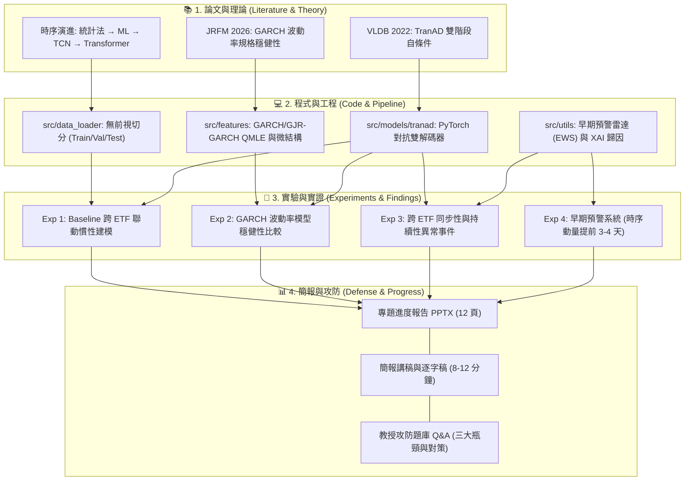

# 🧠 專題知識導航地圖 (Master MOC)
> **專案全稱**：基於多變量 Transformer (TranAD) 之跨 ETF 歷史聯動慣性建模與結構性異常偵測  
> **使用指南**：在 Obsidian 中開啟本資料夾 (`dl`) 作為 Vault，點擊所有 `[[內部連結]]` 即可自由穿梭於論文、程式碼、實驗與簡報之間。

---

## 🗺️ 四大支柱關係全景圖 (Knowledge Graph)

---

## 📚 一、 論文與學術脈絡 (Literature & Theory)

本專案跳脫傳統「單一資產、單日點異常（Point Anomaly）」的框架，核心理論奠基於兩大頂級文獻：

1. **核心模型骨幹**：
   - 深入架構筆記：[[notes/01_TranAD雙階段架構與對抗損失.md|01_TranAD 雙階段自條件架構與對抗損失]]
   - 原始論文：*TranAD: Deep Transformer Networks for Anomaly Detection in Multivariate Time Series* (VLDB 2022) — [`papers/core/p1201-tuli.pdf`](papers/core/p1201-tuli.pdf)
   - 核心要點：
     - **雙階段自條件（Two-Phase Self-Conditioning）**：Phase 1 產生初級殘差作為 Focus Score，Phase 2 透過 Cross-Attention 放大微小異常，防止異常被自編碼器「平滑修復」。
     - **對抗式損失（Adversarial Loss）**：以博弈機制強制模型學會判斷異常邊界。
2. **金融領域結合**：
   - 論文筆記：[[etf_tranad_project/docs/paper_notes/01_JRFM2026_Volatility_TranAD_Notes.md|01_JRFM2026 波動率規格與 TranAD 筆記]]
   - 原始論文：[`papers/core/Volatility Specification... (JRFM, 2026).pdf`](papers/core/Volatility%20Specification%20and%20Deep%20Learning%20Anomaly%20Detection%20Robustness%20of%20Transformer%20Architectures%20to%20GARCH%20Model%20Choice%20%28JRFM,%202026%29.pdf)
   - 核心結論：驗證不同 GARCH 規格（GARCH, GJR-GARCH）在 TranAD 下的 Jaccard 相似度高達 0.85 以上；並指引了金融無界特徵（Linear Head）與 98% 嚴格健康門檻之設定。
3. **基準對照與經典基礎文獻**：
   - 論文筆記：[[etf_tranad_project/docs/paper_notes/02_TCN_TimeSeries_Anomaly_2019_Notes.md|02_TCN 時間序列異常偵測筆記]]（因果卷積與擴張卷積基線）— [`papers/core/Temporal Convolutional Networks... (2019).pdf`](papers/core/Temporal%20Convolutional%20Networks%20for%20Anomaly%20Detection%20in%20Time%20Series%20%282019%29.pdf)
   - 經典深度學習基礎論文彙整：[`papers/classic_dl/`](papers/classic_dl/README.md)（LeNet-5/GTN、AlexNet、Convolution Arithmetic）

---

## 💻 二、 程式模組與工程架構 (Code & Architecture)

專案已完成結構化整理並同步至 `main` 與 `feat/structured-repo` 分支：主要模組化程式碼位於 [`etf_tranad_project/src/`](etf_tranad_project/src/README.md)，而針對原版訓練與計分 Bug 的完整修正版則位於 [`firstry/claude改進版.py`](firstry/claude改進版.py)（獨立更新雙解碼器、單日異常分數、Adj Close 與 Early Stopping）：

| 模組名稱 | 檔案路徑 | 核心職責與防前視設計 |
| :--- | :--- | :--- |
| **資料管線** | `etf_tranad_project/src/data_loader.py` | 動態抓取美股至昨日收盤；**嚴格無前視切分**：Train (2010–2018), Val (2019–2021), Test (2022–最新)；Z-score 僅用 Train 計算。 |
| **模型本體** | `etf_tranad_project/src/models/tranad.py` | PyTorch 實現雙階段 Transformer，含 Positional Encoding、Causal Mask，並依金融特性將輸出改為無激活 `Linear`。 |
| **特徵工程** | `etf_tranad_project/src/features/` | 透過 SciPy QMLE 估計對稱 GARCH(1,1) 與非對稱 GJR-GARCH(1,1)，並加入 Volume Shock 與價差特徵。 |
| **預警與工具** | `etf_tranad_project/src/utils/early_warning.py` | 早期預警系統（四階雷達、速度 $\Delta S$、加速度 $a$）與 XAI 板塊誤差貢獻度分解。 |

---

## 🧪 三、 四大實證實驗矩陣 (Experiments & Findings)

專案規劃並實作了漸進式的四階段實驗，完整對應研究藍圖：[[etf_tranad_project/docs/research_roadmap.md|研究藍圖 (Research Roadmap)]]

### 1. [[etf_tranad_project/experiments/exp1_multi_etf_baseline.py|Exp 1：多 ETF 歷史聯動慣性 Baseline]]
* **目標**：驗證 TranAD 學習跨板塊（`SPY`, `QQQ`, `XLF`, `XLE` 等）定價聯動慣性的能力。
* **XAI 歸因**：當異常發生時，自動拆解重構誤差，判定是宏觀系統性衝擊還是單一板塊裂解。

### 2. [[etf_tranad_project/experiments/exp2_garch_robustness.py|Exp 2：GARCH 條件波動率穩健性]]
* **目標**：比較納入對稱 GARCH 與非對稱 GJR-GARCH 波動率後，TranAD 偵測結果的一致性。
* **成果**：驗證了 JRFM 2026 的結論，Jaccard 相似度高達 0.85+。

### 3. [[etf_tranad_project/experiments/exp3_cross_etf_sync.py|Exp 3：跨 ETF 異常事件與同步性]]
* **多層次定義**：
  * **Level 1 (Point)**：單日重構誤差破表。
  * **Level 2 (Persistent)**：異常持續數天，形成連續事件區間（Sustained Episodes）。
  * **Level 3 (Regime Sync)**：多檔 ETF 同時破表，找出誰是第一張倒下的骨牌（領先板塊）。

### 4. [[etf_tranad_project/experiments/exp4_early_warning_system.py|Exp 4：早期預警系統 (Early Warning System)]]
* 深入專題筆記：[[notes/02_早期預警系統與時序速度動量.md|02_早期預警系統與時序速度動量指標]]
* **核心突破**：利用一階變化速度（Velocity $\Delta S_t$），在 11/04–11/05 暴跌前，於 **10/29–10/30 即提前 3–4 天亮起黃燈預警**。
* **成果輸出**：`etf_tranad_project/results/figures/early_warning_dashboard.png`。

---

## 📊 四、 簡報、進度匯報與教授攻防 (Presentation & Defense)

位於 `報告進度/` 目錄，專為期中審查與指導教授會議打造：

1. **實體簡報與網頁預覽**：
   - 期中專題進度簡報（PPTX）：`報告進度/專題進度報告_ETF異常趨勢偵測.pptx`（由 `create_presentation.py` 生成）
   - 期中網頁預覽：`報告進度/簡報網頁預覽_Slides.html`
   - 600dpi 公式圖庫：`報告進度/equations/`
   - 原版 vs. 改進版教授說明簡報（PPTX，13 頁）：`報告進度/claude改進版_教授說明簡報.pptx`（由 `create_claude_presentation.py` 生成）
   - 教授說明簡報網頁預覽：`報告進度/claude改進版_簡報網頁預覽.html`（視覺與公式圖檔位於 `報告進度/claude_assets/`）
   - 對照實作程式：`firstry/claude改進版.py`（採用獨立 optimizer + `autograd.grad` 分離 Phase 1/Phase 2 對抗訓練並取第 `t` 天 `[:, -1, :]` 分數；對照原版 `firstry/etf_trend_anomaly_有缺陷.py` 與尚未同步修正的 `etf_tranad_project/experiments/exp1`–`exp4`）
2. **完整逐字講稿**：
   - 參考：[[報告進度/簡報講稿與投影片大綱.md|簡報講稿與投影片大綱]]（含 Slide 1–12 講稿、時間分配與過場話術）。
3. **每週進度報告與瓶頸對策**：
   - 教授攻防手冊：[[notes/03_指導教授攻防與研究瓶頸QA.md|03_指導教授攻防與專題研究瓶頸 Q&A]]
   - 參考：[[etf_tranad_project/docs/progress.md|每週會議進度 (Weekly Progress)]]
   - **三大教授必問攻防瓶頸**：
     * **瓶頸 1（門檻墊高）**：2020 疫情導致驗證集門檻失真 $\to$ **解法**：改用 2010–2018 純淨健康常態期 98% 分位數。
     * **瓶頸 2（無界特徵）**：金融報酬率厚尾震盪 $\to$ **解法**：拿掉 Sigmoid 改用 Linear 解碼，評估導入 RobustScaler。
     * **瓶頸 3（異常趨勢定義）**：單日斷斷續續 $\to$ **解法**：以滑動視窗平滑化，建立持久事件（Persistent Event）與跨板塊同步門檻。

---

## 🎯 快速行動指令清單 (Quick Action Checklist)
- [ ] 執行 EWS 實驗驗證最新預警（從 `etf_tranad_project/` 目錄執行）：`python experiments/exp4_early_warning_system.py`
- [ ] 檢視最新儀表板圖表：`etf_tranad_project/results/figures/early_warning_dashboard.png`
- [ ] 檢視原版與改進版模型對照簡報：`報告進度/claude改進版_簡報網頁預覽.html`
- [ ] 演練期中報告講稿：熟讀 `報告進度/簡報講稿與投影片大綱.md`
- [ ] 後續實作待辦：將 `firstry/claude改進版.py` 之分離式對抗訓練修正同步回 `etf_tranad_project/experiments/`，並進行跨 ETF 領先滯後（Lead-Lag）因果關係分析
