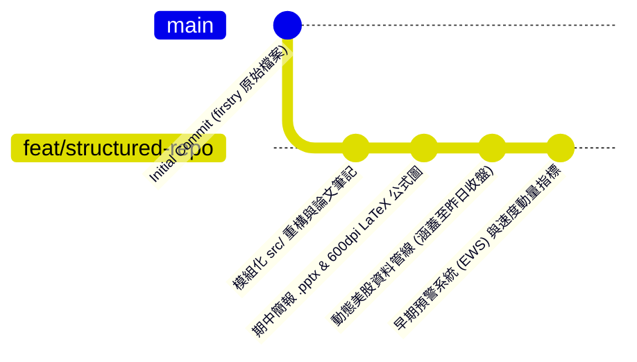

# 基於多變量 Transformer (TranAD) 之跨 ETF 歷史聯動慣性建模與結構性異常偵測

> **大學部專題研究 (Undergraduate Capstone Project)**  
> **核心骨幹**：多變量時序異常偵測模型 **TranAD (VLDB 2022)** 結合金融微結構與 GARCH 條件波動率 (JRFM 2026)  
> **技術棧**：`PyTorch`, `yfinance`, `SciPy (QMLE)`, `pandas`, `NumPy`, `Matplotlib`, `python-pptx`

---

## 🌿 Git 分支架構指南 (Repository Branches)

本專案採行清晰的雙分支架構：**`main` 分支保留專題最初的原型檔案**，**所有重構、進度、簡報與早期預警系統則統一整合於 `feat/structured-repo` 分支**。



---

### 分支清單與定位

| 分支名稱 (Branch) | 分支定位 | 資料涵蓋範圍 | 核心特色與包含內容 |
| :--- | :--- | :---: | :--- |
| **`feat/structured-repo`**<br>*(主進度開發分支)* | **完整專題進度成果<br>(All-in-One)** | **2010–最新<br>(昨日美股收盤)** | • **早期預警系統 (EWS)**：多階預警雷達 (🟢/🟡/🟠/🔴) 與時序動量 ($\Delta S$)<br>• **模組化程式碼**：`src/data_loader`, `models/`, `features/`, `utils/`<br>• **完整實驗群**：`exp1` (基準), `exp2` (GARCH), `exp3` (同步性), `exp4` (預警)<br>• **視覺化儀表板**：`early_warning_dashboard.png`、`etf_anomaly_trend.png`<br>• **Meeting 簡報**：`TranAD_ETF_Meeting_Slides.pptx` 與 14 組 600dpi 公式圖 |
| **`main`**<br>*(基石分支)* | **初始原型與探索沙盒** | **2010–2026 原型** | • 專案最初的原型腳本 (`firstry/etf_trend_anomaly.py`, `test.py`, `project.py`)<br>• 核心文獻原始 PDF 檔案 (`2402.04324v2.pdf` 等)<br>• 保留專案最初的探索樣貌，未做工程重構 |

---

## 🚀 專題進度與核心功能 (`feat/structured-repo`)

### 1. 早期預警系統 (Early Warning System, EWS)
* **起頭提示 (Early Onset)**：傳統模型在暴跌當天才標記異常，EWS 透過監控異常分數的一階變化速度（Velocity $\Delta S_t$），在 11/04–11/05 暴衝前於 **10/29–10/30** 速度陡升時即提前 3–4 天亮起黃燈。
* **多階層動態門檻**：
  * 🟢 **安全常態 (NORMAL, Score < 0.59)**：市場定價慣性穩定。
  * 🟡 **起頭預警 (ONSET_WATCH, 0.59 ≤ Score < 1.71)**：定價慣性開始鬆動，捕捉「不對勁起頭」。
  * 🟠 **結構裂解 (ELEVATED_RISK)**：單一板塊（如 QQQ）貢獻度超過 45%，衝擊外溢。
  * 🔴 **臨界爆發 (CRITICAL, Score ≥ 1.71)**：系統性定價結構崩壞。

### 2. 模組化架構與防前視偏差
* `src/data_loader.py`：動態抓取至昨日收盤，嚴格杜絕前視偏差（Train 2010–2018 / Val 2019–2021 / Test 2022–最新）。
* `src/models/tranad.py`：雙階段自條件回饋（Focus Score）與 Min-Max 對抗神經網路。
* `src/features/`：對稱 `GARCH(1,1)`、非對稱 `GJR-GARCH(1,1)` 波動率與市場微結構指標（Volume Shock, Spread）。

---

## 💻 快速執行指南 (Quickstart)

切換至專題主進度分支：
```bash
git checkout feat/structured-repo
```

### 1. 執行早期預警系統實驗 (EWS 儀表板與起頭診斷)
```bash
cd etf_tranad_project
python experiments/exp4_early_warning_system.py
```
> **產出檔案**：
> * 即時終端診斷與量化避險建議
> * 數據紀錄：`data/processed/early_warning_signals.csv`
> * 視覺化圖表：`results/figures/early_warning_dashboard.png`

### 2. 執行多 ETF 基準對抗訓練實驗
```bash
cd etf_tranad_project
python experiments/exp1_multi_etf_baseline.py
```

---

## 📈 實證檢驗成果 (以近期市場異動為例)

```text
      Date     Score  Velocity    Level   TopContributor  TopContribPct
2026-10-28  3.094184  +0.067220 CRITICAL            XLF          42.3%
2026-10-29  3.470819  +0.376635 CRITICAL            SPY          52.7%
2026-10-30  5.061835  +1.591016 CRITICAL            QQQ          47.7%  <-- 【起頭速度暴增！】
2026-11-02  5.144835  +0.083000 CRITICAL            XLE          55.6%
2026-11-03  5.081343  -0.063492 CRITICAL            XLF          40.1%
2026-11-04 11.015483  +5.934140 CRITICAL            XLE          42.2%  <-- 全面翻倍暴衝
2026-11-05 12.890537  +1.875054 CRITICAL            QQQ          49.5%
```
> **實證結論**：在 11/04–11/05 異常分數從 5 翻倍暴衝至 11～12 之前，系統在 10/29–10/30 即藉由 Velocity（速度從 $+0.06$ 飆升至 $+1.59$）提前 **3–4 個交易日** 捕獲到「不對勁的起頭動量」！
