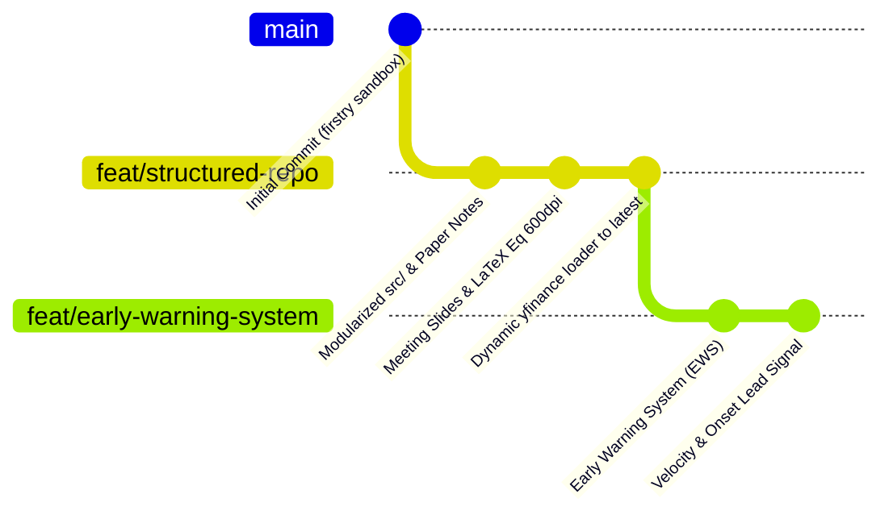

# 基於多變量 Transformer (TranAD) 之跨 ETF 歷史聯動慣性建模與結構性異常偵測

> **大學部專題研究 (Undergraduate Capstone Project)**  
> **核心骨幹**：多變量時序異常偵測模型 **TranAD (VLDB 2022)** 結合金融微結構與 GARCH 條件波動率 (JRFM 2026)  
> **技術棧**：`PyTorch`, `yfinance`, `SciPy (QMLE)`, `pandas`, `NumPy`, `Matplotlib`, `python-pptx`

---

## 🌿 Git 分支地圖與版本導覽 (Branches Architecture)

本專案採用結構化的 Git 分支管理模式，將專案由「初期沙盒探索」推進至「模組化架構」，並進一步延伸出具備實戰價值的「早期預警系統」。各分支角色定位與功能如下：



---

### 分支清單與功能對照表

| 分支名稱 (Branch) | 分支定位 | 資料涵蓋範圍 | 核心特色與包含檔案 | 推薦使用場景 |
| :--- | :--- | :---: | :--- | :--- |
| **`feat/early-warning-system`**<br>*(最新前瞻分支)* | **早期預警與起頭提示** | **2010–最新<br>(昨日美股收盤)** | • 多階層動態預警雷達 (🟢 正常 / 🟡 起頭 / 🟠 裂解 / 🔴 爆發)<br>• 時序速度與加速度動量指標 ($\Delta S$, $a_t$)<br>• 三層預警儀表板 (`early_warning_dashboard.png`)<br>• 獨立實驗腳本 (`exp4_early_warning_system.py`) | **專題成果展示、即時市場風險監控、找尋崩跌前夕轉折點** |
| **`feat/structured-repo`**<br>*(工程模組化分支)* | **完整工程重構與簡報** | **2010–最新<br>(昨日美股收盤)** | • 模組化原始碼 (`src/data_loader`, `models/`, `features/`)<br>• JRFM 2026 與 TCN 2019 論文筆記 (`docs/paper_notes/`)<br>• 期中審查簡報 (`TranAD_ETF_Meeting_Slides.pptx`)<br>• 600dpi LaTeX 公式透明圖 (PNG/SVG)<br>• 基礎對抗訓練與 XAI 歸因實驗 (`exp1` ~ `exp3`) | **模組化程式碼研讀、期中 Meeting 簡報製作、基礎對照組實驗** |
| **`main`**<br>*(基石分支)* | **初始原型與探索沙盒** | **2010–2026 原型** | • 專案最初的原型腳本 (`firstry/etf_trend_anomaly.py`, `test.py`)<br>• 原始文獻 PDF 檔案 (`2402.04324v2.pdf` 等)<br>• 早期資料探勘與概念驗證 (PoC) | **追溯專案最初發想、檢視最原始的探索式腳本** |

---

## 🚀 各分支詳細內容說明

### 1. `feat/early-warning-system`（目前最新推薦分支）
* **解決問題**：傳統時序異常偵測採用單一二元門檻（Binary Threshold），往往在暴跌發生當天才標記紅燈，缺乏事前的領先警示能力。
* **核心實作**：
  * [`src/utils/early_warning.py`](etf_tranad_project/src/utils/early_warning.py)：
    * 雙重防線門檻：以常態訓練集計算 90th 百分位（起頭警戒線 $T_{\text{watch}}$）與 98th 百分位（臨界爆發線 $T_{\text{crit}}$）。
    * 速度與加速度：監控 $\Delta \text{Score}_t = S_t - S_{t-1}$。若速度連續急遽抬頭，提早於絕對分數破表前 3–4 天觸發「🟡 不對勁起頭」提示。
    * 即時狀態報告生成器：輸出包含燈號、主要失真板塊（XAI）與量化避險建議。
  * [`experiments/exp4_early_warning_system.py`](etf_tranad_project/experiments/exp4_early_warning_system.py)：完整的回測評估腳本。
  * [`results/figures/early_warning_dashboard.png`](etf_tranad_project/results/figures/early_warning_dashboard.png)：三層視覺化儀表板。

---

### 2. `feat/structured-repo`（工程重構與文獻簡報分支）
* **模組化架構**：
  * `src/data_loader.py`：嚴格杜絕前視偏差（Look-ahead Bias）之滑動視窗（$K=30$）與時間切分。
  * `src/models/tranad.py`：雙階段自條件回饋（Phase 1 Focus Score）與 Min-Max 對抗神經網路。
  * `src/models/vtt.py`：因果擴張卷積與時空 Transformer 對照模型。
  * `src/features/`：GARCH(1,1) / GJR-GARCH 波動率與市場微結構特徵（Volume Shock, Spread）。
* **學術與簡報資源**：
  * `docs/TranAD_ETF_Meeting_Slides.pptx`：專業期中進度報告投影片（微軟雅黑 / 深藍高質感金融風）。
  * `docs/progress.md`：每週 Meeting 進度審查文檔。
  * `results/figures/equations/`：14 組 600dpi 高解析度 LaTeX 數學公式圖片（PNG 與 SVG 向量圖）。

---

### 3. `main`（原始基石分支）
* 保存專題最初的概念驗證（Proof of Concept）檔案：
  * `firstry/etf_trend_anomaly.py`：單檔整合式訓練與繪圖腳本。
  * `firstry/test.py`、`firstry/vsd.py`：初期技術驗證腳本。
  * 核心文獻 PDF（VLDB TranAD, JRFM 2026, TCN 2019）。

---

## 💻 快速切換與執行指南 (Quickstart)

### 1. 切換至最新早期預警分支 (`feat/early-warning-system`)
```bash
git checkout feat/early-warning-system
```

#### 執行早期預警系統實驗 (EWS)
```bash
cd etf_tranad_project
python experiments/exp4_early_warning_system.py
```
> **產出**：
> * 終端即時診斷報告（包含當前預警燈號與量化避險建議）
> * `data/processed/early_warning_signals.csv`（每日詳細預警數據）
> * `results/figures/early_warning_dashboard.png`（三層視覺化儀表板）

---

### 2. 切換至模組化架構分支 (`feat/structured-repo`)
```bash
git checkout feat/structured-repo
```

#### 執行多 ETF 基準對抗訓練實驗
```bash
cd etf_tranad_project
python experiments/exp1_multi_etf_baseline.py
```

---

## 📈 實證檢驗成果 (以近期市場異動為例)

系統於 2026 年最新盲測集上的檢驗表現：
```text
      Date     Score  Velocity    Level   TopContributor  TopContribPct
2026-10-28  3.094184  +0.067220 CRITICAL            XLF          42.3%
2026-10-29  3.470819  +0.376635 CRITICAL            SPY          52.7%
2026-10-30  5.061835  +1.591016 CRITICAL            QQQ          47.7%  <-- 【起頭速度暴增！】
2026-11-02  5.144835  +0.083000 CRITICAL            XLE          55.6%
2026-11-03  5.081343  -0.063492 CRITICAL            XLF          40.1%
2026-11-04 11.015483  +5.934140 CRITICAL            XLE          42.2%  <-- 全面翻倍暴衝
2026-11-05 12.890537  +1.875054 CRITICAL            QQQ          49.5%
```
> **關鍵結論**：在異常分數於 11/04–11/05 翻倍暴衝前，系統早在 10/29–10/30 即藉由分數速度（Velocity 由 $+0.06$ 飆升至 $+1.59$）提前 **3–4 個交易日** 發出微結構解耦之起頭預警！
