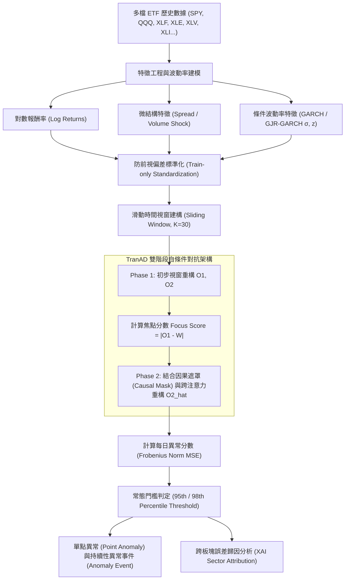

# 基於多變量 Transformer (TranAD) 之跨 ETF 歷史聯動慣性建模與結構性異常偵測

> **大學部專題研究 (Undergraduate Capstone Project)**  
> **核心架構**：透過多變量 Transformer（**TranAD**）學習多檔 ETF 之間的歷史聯動慣性（Normal Pricing Dynamics）  
> **使用技術**：Python, PyTorch, yfinance, SciPy (QMLE), Scikit-learn, Matplotlib

---

## 一、 專題背景與研究動機 (Motivation)

在金融市場中，大盤指數型 ETF（如 `SPY`、`QQQ`）與各產業板塊 ETF（如金融 `XLF`、能源 `XLE`、醫療 `XLV`、工業 `XLI`、科技 `XLK` 等）在正常市場狀態下存在穩定的**歷史聯動慣性（Normal Pricing Dynamics）**。

傳統單變量異常偵測僅關注單一資產的極端報酬率，往往忽略了**跨資產結構相關性解耦（Structural Decoupling）**的風險訊號；且傳統點異常偵測（Point Anomaly Detection）難以區分「單日雜訊」與「持續數日的結構性異常事件（Persistent Anomaly Event）」。本研究旨在：
1. **學習多變量聯動慣性**：透過多變量 Transformer（**TranAD**）之雙階段自條件與演化式對抗訓練，學習多檔 ETF 在常態時期的跨資產時序依賴關係。
2. **結合金融波動率動態**：引入計量經濟學之對稱與非對稱波動率模型（`GARCH(1,1)`、`GJR-GARCH(1,1)`）與市場微結構特徵（價差解耦、爆量衝擊），探討波動率規格對異常偵測之影響。
3. **跨板塊異常歸因分析（XAI）與異常趨勢識別**：拆解各 ETF 在異常發生當下的重構誤差貢獻度，診斷異常事件屬於「宏觀系統性風險」或「特定板塊結構性破裂」，並延伸分析跨 ETF 同步異常趨勢。

---

## 二、 系統架構 (System Architecture)



### 核心方法亮點
* **防範前視偏差（Look-ahead Bias Prevention）**：嚴格依時間軸劃分訓練集（2010–2018）、驗證集（2019–2021）與盲測集（2022–2026），僅使用訓練集統計量進行 Z-score 標準化與波動率參數估計，並在 Transformer Encoder 中加入上三角因果遮罩（Causal Mask）。
* **雙階段自條件與對抗損失（Two-Phase Self-Conditioning & Adversarial Loss）**：第一階段產生初步重建並計算殘差作為 Focus Score，放大潛在微妙異常；第二階段透過演化權重 $\frac{1}{\text{epoch}}$ 進行 Min-Max 對抗訓練，強化常態邊界辨識能力。
* **可解釋異常歸因（XAI Attribution）**：將異常日之總體重構誤差拆解至各別板塊 ETF，量化各資產對結構破壞的貢獻百分比。

---

## 三、 專案目錄結構 (Repository Structure)

```text
etf_tranad_project/
├── README.md                        # 專題總覽（展示動機、架構、重現步驟，供教授與評審檢閱）
├── requirements.txt                 # 依賴套件清單
├── .gitignore                       # Git 忽略規則設定
│
├── data/                            # 【數據集存放區】
│   ├── raw/                         # yfinance 下載之原始收盤價與成交量快取
│   └── processed/                   # 對數報酬率、標準化視窗數據與匯出結果
│       ├── tranad_anomaly_results.csv
│       └── tranad_etf_scores.csv
│
├── docs/                            # 【論文閱讀筆記與 Meeting 報告】
│   ├── progress.md                  # 每週與指導教授 Meeting 的進度報告紀錄
│   ├── research_roadmap.md          # 專題延伸方向規劃
│   └── paper_notes/                 # 論文閱讀筆記整理
│       ├── 01_JRFM2026_Volatility_TranAD_Notes.md
│       └── 02_TCN_TimeSeries_Anomaly_2019_Notes.md
│
├── src/                             # 【核心程式碼模組】
│   ├── data_loader.py               # 跨 ETF 數據下載、滑動視窗 (WindowDataset) 與防前視偏差切分
│   ├── features/
│   │   ├── microstructure.py        # 價差解耦 (Spread)、爆量倍數 (Volume Shock) 特徵
│   │   └── garch_volatility.py      # GARCH(1,1) 與 GJR-GARCH QMLE 波動率特徵萃取
│   ├── models/
│   │   ├── tranad.py                # TranAD 模型、PositionalEncoding 與雙階段自條件注意力
│   │   └── vtt.py                   # 對照組：Variable-Temporal Transformer 與因果擴張卷積
│   └── utils/
│       ├── attribution.py           # 跨 ETF 異常貢獻度歸因分析 (XAI) 與持續性異常事件判定
│       └── visualization.py         # ETF 價格走勢、異常觸發紅線與重構誤差門檻圖繪製
│
├── experiments/                     # 【實驗執行腳本】
│   ├── exp1_multi_etf_baseline.py   # 實驗一：大盤與板塊 ETF 歷史聯動慣性異常偵測與 XAI 歸因
│   ├── exp2_garch_robustness.py     # 實驗二：不同波動率規格 (GARCH vs GJR-GARCH) 對 TranAD 穩健性驗證
│   └── exp3_cross_etf_sync.py       # 實驗三：9 檔 ETF 同步異常事件與趨勢分析
│
└── results/                         # 【圖表與模型權重輸出】
    ├── figures/                     # 專題簡報用之視覺化對照圖
    └── checkpoints/                 # 訓練完成之 PyTorch 模型權重 (.pt)
```

---

## 四、 環境安裝與執行步驟 (Getting Started)

### 1. 環境建置
建議使用 Python 3.10+ 安裝所需套件：
```bash
cd etf_tranad_project
pip install -r requirements.txt
```

### 2. 執行專題實驗
* **實驗一：跨板塊 ETF 聯動慣性異常偵測與 XAI 歸因分析**
  ```bash
  python -m experiments.exp1_multi_etf_baseline
  ```
* **實驗二：GARCH vs. GJR-GARCH 波動率規格對 TranAD 之穩健性驗證**
  ```bash
  python -m experiments.exp2_garch_robustness
  ```
* **實驗三：多檔 ETF 跨資產同步異常與異常事件分析**
  ```bash
  python -m experiments.exp3_cross_etf_sync
  ```

---

## 五、 參考文獻 (References)

1. *Volatility Specification and Deep Learning Anomaly Detection: Robustness of Transformer Architectures to GARCH Model Choice*, Journal of Risk and Financial Management (JRFM), 2026. ([論文 PDF](../Volatility%20Specification%20and%20Deep%20Learning%20Anomaly%20Detection%20Robustness%20of%20Transformer%20Architectures%20to%20GARCH%20Model%20Choice%20(JRFM,%202026).pdf))
2. Tuli, S., Casale, G., & Jennings, N. R. (2022). *TranAD: Deep Transformer Networks for Anomaly Detection in Multivariate Time Series Data*. Proceedings of the VLDB Endowment.
3. He, Y., & Zhao, J. (2019). *Temporal Convolutional Networks for Anomaly Detection in Time Series*. ([論文 PDF](../Temporal%20Convolutional%20Networks%20for%20Anomaly%20Detection%20in%20Time%20Series%20(2019).pdf))
