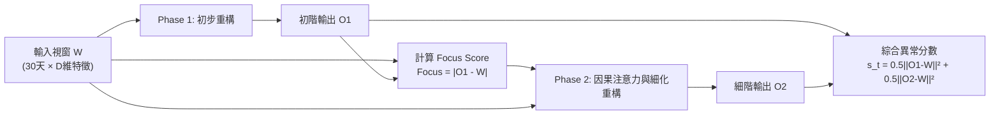

# 🧩 TranAD 雙階段自條件架構與對抗損失機制

> **主要文獻**：*TranAD: Deep Transformer Networks for Anomaly Detection in Multivariate Time Series* (VLDB 2022)  
> **程式碼對應**：`etf_tranad_project/src/models/tranad.py`

---

## 1. 為什麼傳統 Autoencoder 不夠用？
在時間序列異常偵測中，傳統的自編碼器（Autoencoder / VAE）有一個致命缺點：**「過度強大的重構能力」**。  
當異常偏離很微小時，Autoencoder 往往會「順手」把異常點修復成正常樣貌，導致重構誤差（Reconstruction Error）不明顯，產生嚴重的漏報（False Negative）。

---

## 2. TranAD 的核心解法：雙階段自條件 (Two-Phase Self-Conditioning)

TranAD 提出雙階段編碼-解碼架構，藉由前一階段的誤差回饋，強迫模型「聚焦」在可疑點上：

### Phase 1：粗重構與焦點生成 (Focus Score)
* 透過 Transformer Encoder-Decoder 得到初步重構值 $O_1$。
* 計算每個特徵、每個時間點的初步殘差：
  $$\text{Focus} = |O_1 - W|$$

### Phase 2：細化重構 (Causal Masking & Cross Attention)
* 將原始視窗 $W$ 與 $\text{Focus}$ 結合，透過 Cross-Attention 機制，讓神經網路把注意力大幅傾斜至「第一階段有殘差」的可疑位置。
* 引入 **上三角因果遮罩 (Causal Mask)**，保證推論時不會看見未來的資料點（避免前視偏差）。

---

## 3. 演化對抗損失函數 (Adversarial Training)

借鑑 GAN 的博弈精神，TranAD 讓兩個解碼器相互抗衡，演化權重隨訓練週期遞減：$w = \frac{1}{\text{epoch}}$。

$$\mathcal{L}_1 = w \|O_1 - W\|_2^2 + (1 - w) \|\hat{O}_2 - W\|_2^2$$
$$\mathcal{L}_2 = w \|O_2 - W\|_2^2 - (1 - w) \|\hat{O}_2 - W\|_2^2$$

* **效果**：強制拉大正常與異常樣本之間的重構誤差差距，防止異常點被平滑化。

---

## 4. 本專題的金融化改造 (Financial Adaptation)

原版 TranAD 設計給工業感測器（特徵皆介於 0 到 1 之間，最後一層使用 `Sigmoid`）。本專題配合金融資料特性做出以下關鍵修正：
1. **解除無界特徵限制**：拿掉 `Sigmoid`，改用無激活函數的 `Linear` 層，適應厚尾日報酬率。
2. **算子維度修正**：計分從 Mean 改為 Frobenius 範數平方和（`torch.sum`），保留跨資產總體衝擊量級。
